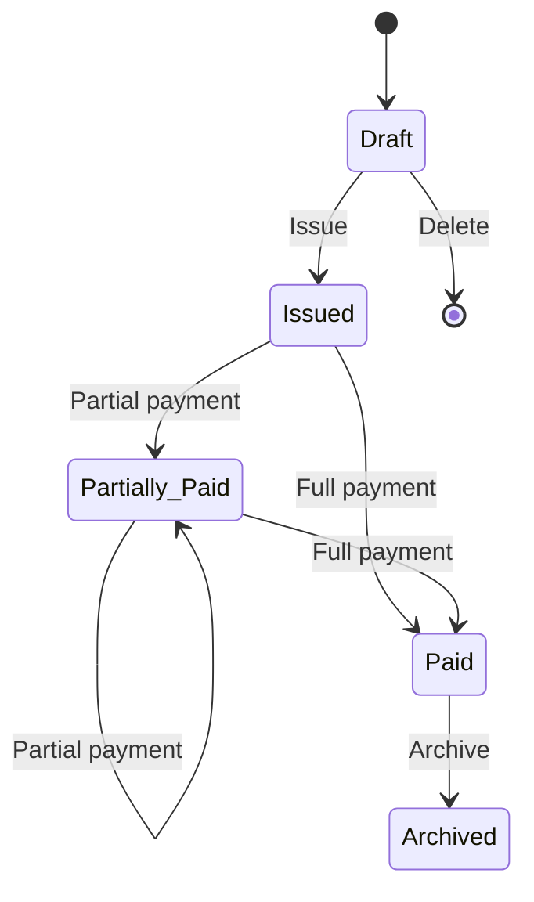

# Invoice Status

## Purpose

Defines the business lifecycle of an Invoice within the Finance Management System.

Invoice Status represents the current business state of an Invoice and determines the operations that may be performed on it.

---

# Responsibilities

Invoice Status SHALL:

- Represent the current lifecycle state of an Invoice.
- Govern which business operations are permitted.
- Prevent invalid state transitions.
- Support tracking of invoice progress.

---

# Lifecycle

An Invoice progresses through the following lifecycle.

The exact transitions SHALL be governed by Business Rules.

---

# Status Definitions

## Draft

A Draft Invoice is under preparation

Characteristics:

- May be edited.
- May add or remove Invoice Items.
- May be deleted.
- Has not been issued to the Customer.

---

## Issued

An Issued Invoice has been finalized and delivered to the Customer.

Characteristics:

- Cannot be structurally modified.
- May receive Payments.
- Remains outstanding until fully paid.

---

## Partially Paid

A Partially Paid Invoice has received one or more Payments but still has an outstanding balance.

Characteristics:

- Additional Payments are permitted.
- Outstanding balance remains greater than zero.
- Invoice remains active.

---

## Paid

A Paid Invoice has no remaining outstanding balance.

Characteristics:

- No further Payments are permitted.
- Financial obligation is satisfied.
- Invoice becomes read-only.

---

## Archived

An Archived Invoice is retained for historical purposes.

Characteristics:

- Read-only.
- Cannot receive Payments.
- Available for reporting and audit.

---

# State Transitions

The following transitions are permitted.

| From            | To              | Trigger                                      |
|-----------------|-----------------|----------------------------------------------|
| Draft           | Issued          | Issue Invoice                                |
| Issued          | Partially Paid  | Record Payment (balance remains greater than zero) |
| Issued          | Paid            | Record Payment (balance becomes zero)        |
| Partially Paid  | Partially Paid  | Record Payment (balance remains greater than zero) |
| Partially Paid  | Paid            | Record Payment (balance becomes zero)        |
| Paid            | Archived        | Archive Invoice                              |

Additional rules:
- Only Draft Invoices MAY be deleted. ([[01-Requirements/billing/Invoice#BR-INV-012|BR-INV-012]])
- Structural modification (add/remove/update items) is permitted only in Draft.
- Payments are permitted only in Issued and Partially Paid.
- No further Payments are permitted in Paid or Archived.
- Archived is read-only. No payments, no structural changes.
- Transitions not listed above SHALL be rejected unless explicitly permitted by Business Policy.
- Deletion is not a status transition.

---

# Related Business Rules

- [[01-Requirements/billing/Invoice#BR-INV-011|BR-INV-011]] — No modification after issuance
- [[01-Requirements/billing/Invoice#BR-INV-012|BR-INV-012]] — Only Drafts may be deleted
- [[01-Requirements/billing/Invoice#BR-INV-013|BR-INV-013]] — Document Number assigned at issuance
- [[01-Requirements/billing/Payment#BR-PAY-004|BR-PAY-004]] — Overpayment handling
- [[01-Requirements/billing/Customer-Credit#BR-CC-012|BR-CC-012]] — Customer Credit requires Issued or Partially Paid

---

# Related Business Policies

- [[Billing-Policies#BP-INV-001|BP-INV-001]] — Draft Invoice deletion
- [[Billing-Policies#BP-INV-003|BP-INV-003]] — Issued Invoice modification
- [[Billing-Policies#BP-INV-004|BP-INV-004]] — Invoice voiding
- [[Billing-Policies#BP-PAY-001|BP-PAY-001]] — Partial payments
- [[Billing-Policies#BP-PAY-002|BP-PAY-002]] — Overpayment handling
- [[Billing-Policies#BP-PAY-004|BP-PAY-004]] — Customer Credit application

---

# Related Concepts

- [[01-Requirements/billing/Invoice|Invoice]]
- [[01-Requirements/billing/InvoiceItem|Invoice Item]]
- [[01-Requirements/billing/Payment|Payment]]
- [[01-Requirements/billing/Receipt|Receipt]]
- [[01-Requirements/billing/Customer-Credit|Customer Credit]]
- [[01-Requirements/billing/Document|Document]]

---

# Future Considerations

Future versions MAY introduce additional statuses, including:

- Void
- Cancelled
- Written Off
- Disputed

Such statuses SHALL preserve a well-defined lifecycle.