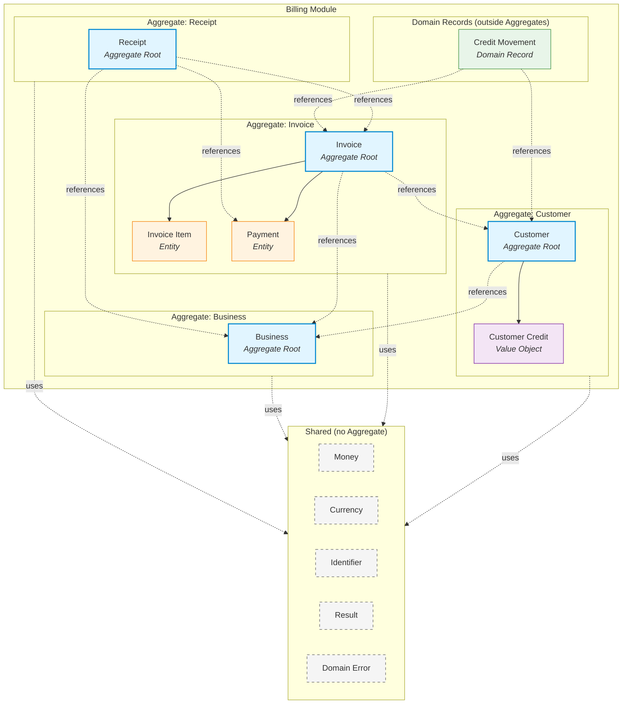

# Aggregate Map

## Purpose

This document provides a visual and textual map of the Aggregates within the Finance Management System.

It exists to:

- Clarify Aggregate boundaries.
- Show cross-Aggregate reference directions.
- Identify owned components (Entities and Value Objects).
- Document Shared concepts.
- Prevent accidental boundary violations.

This document is authoritative for Aggregate boundaries.

Where this document and any other document disagree, this document SHALL be updated first, then other documents brought into alignment.

---

# Aggregate Boundaries

The following diagram shows all Aggregates, their owned components, and Shared concepts.

---

# Aggregate Summary

| Aggregate | Root | Owned Components | Type |
|-----------|------|------------------|------|
| Business | Business | (none) | Aggregate Root |
| Customer | Customer | Customer Credit | Aggregate Root |
| Invoice | Invoice | Invoice Item, Payment | Aggregate Root |
| Receipt | Receipt | (none) | Aggregate Root |
| — | Credit Movement | — | Domain Record (outside Aggregates) |

---

# Aggregate Details

## Business Aggregate

### Root
[[03-domain/billing/aggregates/Business|Business]]

### Owned Components
None.

### References
None.

### Referenced By
- [[03-domain/billing/aggregates/Customer|Customer]]
- [[03-domain/billing/aggregates/Invoice|Invoice]]
- [[03-domain/billing/aggregates/Receipt|Receipt]]

### Purpose
Provides the organizational context for all billing operations.

---

## Customer Aggregate

### Root
[[03-domain/billing/aggregates/Customer|Customer]]

### Owned Components
- [[03-domain/billing/value objects/Customer-Credit|Customer Credit]] (Value Object)

### References
- [[03-domain/billing/aggregates/Business|Business]]

### Referenced By
- [[03-domain/billing/aggregates/Invoice|Invoice]]
- [[03-domain/billing/aggregates/Receipt|Receipt]]
- [[03-domain/billing/Credit-Movement|Credit Movement]]

### Purpose
Represents the recipient of billing activities and holds customer-specific state, including Customer Credit balance.

### Notes
- Customer Credit changes produce new Value Object instances.
- Movement history is tracked through [[03-domain/billing/Credit-Movement|Credit Movement]] records — NOT inside this Aggregate.

---

## Invoice Aggregate

### Root
[[03-domain/billing/aggregates/Invoice|Invoice]]

### Owned Components
- [[03-domain/billing/aggregates components/InvoiceItem|Invoice Item]] (Entity)
- [[03-domain/billing/aggregates components/Payment|Payment]] (Entity)

### References
- [[03-domain/billing/aggregates/Business|Business]]
- [[03-domain/billing/aggregates/Customer|Customer]]

### Referenced By
- [[03-domain/billing/aggregates/Receipt|Receipt]]
- [[03-domain/billing/Credit-Movement|Credit Movement]]

### Purpose
Represents the financial obligation owed by a Customer to the Business. Owns its line items and payments.

### Notes
- Payments are Entities within this Aggregate — NOT an independent Aggregate.
- Invoice Items are Entities within this Aggregate — NOT an independent Aggregate.
- All structural changes to Invoice Items and recording of Payments SHALL occur through the Invoice Aggregate Root.

---

## Receipt Aggregate

### Root
[[03-domain/billing/aggregates/Receipt|Receipt]]

### Owned Components
None.

### References
- [[03-domain/billing/aggregates/Business|Business]]
- [[03-domain/billing/aggregates/Invoice|Invoice]]
- [[03-domain/billing/aggregates components/Payment|Payment]] (within Invoice)

### Referenced By
None.

### Purpose
Provides immutable documentary evidence of a successfully recorded Payment.

### Notes
- Receipts are immutable after generation.
- Receipts do not modify any other Aggregate.

---

# Domain Records

Domain Records are **not** Aggregates.

They document business facts outside any Aggregate boundary.

## Credit Movement

### Documented By
[[03-domain/billing/Credit-Movement|Credit Movement]]

### References
- [[03-domain/billing/aggregates/Customer|Customer]]
- [[03-domain/billing/aggregates/Invoice|Invoice]]

### Purpose
Records every change to a Customer's credit balance.

### Notes
- Immutable after creation.
- Owned by no Aggregate.
- Persisted through its own Repository (defined in Domain, implemented in Persistence).
- Queried independently of Customer loading.

---

# Shared Concepts

Shared concepts are used across Aggregates but owned by none.

| Concept | File | Type |
|---------|------|------|
| [[03-domain/shared/Money|Money]] | `03-domain/shared/Money.md` | Value Object |
| [[03-domain/shared/Currency|Currency]] | `03-domain/shared/Currency.md` | Value Object |
| [[03-domain/shared/Identifier|Identifier]] | `03-domain/shared/Identifier.md` | Value Object |
| [[03-domain/shared/Result|Result]] | `03-domain/shared/Result.md` | Value Object |
| [[03-domain/shared/DomainError|Domain Error]] | `03-domain/shared/DomainError.md` | Value Object |

Shared concepts SHALL remain independent of any Billing Aggregate.

---

# Cross-Aggregate Reference Rules

## Rule 1 — Reference by Identity

Aggregates SHALL reference other Aggregates by Identifier only.

Aggregates SHALL NOT hold direct object references to other Aggregate Roots.

Example

Invoice holds:
- `businessId: Identifier`
- `customerId: Identifier`

Invoice does NOT hold:
- `business: Business`
- `customer: Customer`

## Rule 2 — Aggregate Consistency and Cross-Aggregate Operations

An Aggregate SHALL maintain its own consistency independently.

A business operation MAY modify multiple Aggregates within a single Application-layer transaction when atomicity is required.

The Application layer SHALL coordinate cross-Aggregate changes.

Example

Recording a Payment with Customer Credit:

1. Application updates Invoice Aggregate (records Payment, updates Balance).
2. Application updates Customer Aggregate (reduces Customer Credit).
3. Application persists a Credit Movement record.
4. The Application-layer transaction commits all changes together or none of them.

The Invoice Aggregate SHALL NOT directly modify the Customer Aggregate.
The Application layer is the only component that coordinates multiple Aggregates.

---

## Rule 3 — Reference Direction

Reference direction follows business dependency:

| Aggregate | References |
|-----------|------------|
| Customer | Business |
| Invoice | Business, Customer |
| Receipt | Business, Invoice |

Circular references SHALL NOT exist.

## Rule 4 — No Cross-Aggregate Invariants

An Aggregate SHALL NOT enforce invariants that depend on another Aggregate's state.

Example

Invoice SHALL NOT enforce "Customer has sufficient Credit" as an internal invariant.

This is an Application-layer coordination concern.

## Rule 5 — Domain Records Are Outside Aggregates

Domain Records (such as Credit Movement) SHALL NOT be loaded as part of any Aggregate.

They are queried independently through their own Repository.

## Rule 6 — Shared Concepts Are Immutable

Shared Value Objects SHALL NOT be modified by any Aggregate.

They are passed by value.

---

# Boundary Decisions (Rationale)

## Why Payment is inside Invoice

- Payment immutability + Invoice balance update must be atomic.
- BR-INV-008 (Balance = Total − Payments) requires Invoice to own Payments.
- Recording a Payment is naturally an Invoice operation.
- Overpayment handling requires Payment to coordinate with Invoice Balance.

## Why Customer Credit is inside Customer

- Customer Credit is a monetary quantity tied to a specific Customer.
- Balance changes must be atomic with other Customer state updates.
- Customer Credit is a Value Object — replaced on change.

## Why Credit Movement is outside Customer

- Movements can grow unbounded; loading them with Customer would bloat the Aggregate.
- Movements are queried independently for reporting.
- Movements are immutable facts, not state.
- Movements describe history, not current state.

## Why Receipt is a separate Aggregate

- Receipt does not modify any other Aggregate.
- Receipt is immutable after generation.
- Receipt is documentary evidence, not state.
- Independence simplifies persistence.

## Why Business is a separate Aggregate

- Business is organizational context, referenced by all others.
- Business changes SHALL NOT cascade to Invoices (BR-BUS-008).
- Business is read-heavy, write-rare.

---

# Evolution

When new Aggregates are introduced:

1. Add them to the Aggregate Boundaries diagram.
2. Document their Root, Owned Components, References, and Purpose.
3. Update Cross-Aggregate Reference Rules if needed.
4. Record the boundary decision rationale.

When Aggregate boundaries change:

1. Document the reason as an Architecture Decision Record (ADR).
2. Update this document.
3. Update affected Aggregate specifications.

---

# Related Documents

- [[02-architecture/Module-Architecture|Module Architecture]]
- [[02-architecture/Dependency-Rules|Dependency Rules]]
- [[02-architecture/Persistence-Strategy|Persistence Strategy]]
- [[03-domain/Domain-Services|Domain Services]]
- [[03-domain/billing/aggregates/Business|Business]]
- [[03-domain/billing/aggregates/Customer|Customer]]
- [[03-domain/billing/aggregates/Invoice|Invoice]]
- [[03-domain/billing/aggregates/Receipt|Receipt]]